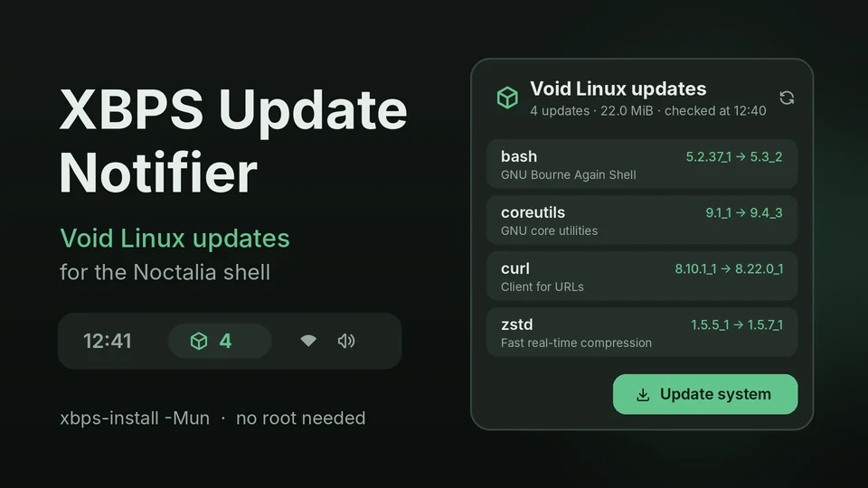

# XBPS Update Notifier

XBPS Update Notifier tells you when your Void Linux system can be updated. It
asks XBPS for pending updates in the background, shows their number in the bar,
lists them with old and new versions in a panel, sends a notification when new
updates appear, and starts the upgrade in a terminal with one click.



## Plugin

| Field | Value |
| --- | --- |
| ID | `gluow3377/xbps-notify` |
| Entries | Bar widget: `widget`; panel: `panel`; service: `service`; shortcut: `shortcut` |

## Requirements

- Void Linux with `xbps-install` and `xbps-query` (the `xbps` package) on `PATH`.
- One of `sudo`, `doas` or `pkexec` to run the upgrade. They are tried in that
  order unless you pick one in the settings; `pkexec` needs a running polkit
  agent.
- A terminal emulator for the upgrade: `$TERMINAL`, or one Noctalia finds on
  `PATH` (foot, alacritty, kitty, ...).

Checking for updates needs neither root nor a terminal.

## Usage

Enable the plugin, then add the **XBPS Update Notifier** widget under
**Settings → Bar → Add Widget**. The first check runs within half a minute
after Noctalia starts, then every hour by default.

The widget shows a package glyph with the number of pending updates, in the
accent color while there is something to update. Its tooltip lists the first
packages, the download size and the time of the last check.

| Action | Where | Effect |
| --- | --- | --- |
| Left click | Bar widget | Open or close the update panel |
| Right click | Bar widget | Check now and report the result in a notification |
| Middle click | Bar widget | Widget settings |
| Refresh button | Panel | Check now |
| Update system | Panel | Open a terminal running the upgrade |

The panel lists every pending update with its installed and new version, the
package description and download size, plus the other entries of the same
transaction (new dependencies, removals). Toggle it from a keybind with:

```sh
noctalia msg panel-toggle gluow3377/xbps-notify:panel
```

The control-center tile shows the same count; add it under
**Settings → Control Center → Home Shortcuts**. Click opens the panel, right
click checks now.

**Update system** runs `sudo xbps-install -Su` (or `doas`/`pkexec`) in a
terminal, so you can enter the password and confirm the transaction. The window
stays open until you press Enter, and the plugin checks again as soon as the
upgrade ends.

## Settings

| Setting | Type | Default | Description |
| --- | --- | --- | --- |
| `check_interval` | `int` | `60` | Minutes between checks. Set to `0` to check only at startup, on request and after packages change. |
| `sync_repos` | `bool` | `true` | Fetch the repository index into memory on every check (`xbps-install -M`). When off, only the local cache is read, which is as fresh as the last `xbps-install -S` run as root. |
| `notify` | `bool` | `true` | Notify when updates appear that were not announced before. While announced updates are still pending, newer ones are announced at most every 6 hours. |
| `notify_threshold` | `int` | `1` | Notify only when at least this many updates are pending. |
| `ignored_packages` | `string_list` | `[]` | Packages left out of the count and the notifications. `*` wildcards work, e.g. `linux*`. They are still upgraded; use `xbps-pkgdb -m hold <pkg>` to keep a package back. |
| `elevation` | `select` | `auto` | How the upgrade gets root: `auto`, `sudo`, `doas` or `pkexec`. |
| `update_command` | `string` | empty | Advanced. Replaces the built-in upgrade command; runs with `sh` in a terminal. |
| `glyph` | `glyph` | `package` | Widget glyph. |
| `hide_when_updated` | `bool` | `false` | Hide the widget while there is nothing to update (it still shows up when a check fails). |

## IPC

```sh
# Check now and report the result in a notification
noctalia msg plugin gluow3377/xbps-notify:service all check

# Open a terminal running the upgrade
noctalia msg plugin gluow3377/xbps-notify:service all update
```

## Notes

- The check is `xbps-install -Mun`: a dry run of a full system upgrade that
  needs no root. `-M` downloads each repository index into memory (a few MiB
  per repository and check) and writes nothing to disk. A local
  `xbps-query -l` adds the installed versions to the list.
- The plugin also checks again shortly after `/var/db/xbps/pkgdb-*.plist` changes,
  so the count drops right after you upgrade, however you did it.
- While XBPS itself is outdated, `xbps-install` refuses every other update and
  its dry run lists only `xbps`. The plugin then says so, and the upgrade command
  updates `xbps` first and the rest right after.
- Held packages (`xbps-pkgdb -m hold`) are not counted; the panel mentions them.
- Notifications: new updates are announced right away. While announced
  updates are still pending, newer ones (Void publishes updates many times a
  day) are announced at most every 6 hours. A Noctalia restart, e.g. a new
  login, reminds you once.
- When a check fails (no network, unresolvable dependencies while a mirror
  syncs), the last known list stays on screen with the error and the check is
  retried after 5 minutes, then 10, 20, 40, never less often than the check
  interval. When every repository is unreachable, XBPS still exits with
  success and an empty plan, so the plugin treats that as a failed check, never as
  "up to date". When XBPS prints a plan but reports a problem too (one mirror
  unreachable, not enough disk space), the list is shown with a warning.
- A check that has not come back after 2.5 minutes is abandoned, and checking
  carries on.
- Processes started: `xbps-install`, `xbps-query`, and for the upgrade a
  terminal running `sh -lc` with the upgrade command followed by
  `noctalia msg plugin gluow3377/xbps-notify:service all check after-update`.
  The plugin reads `/var/db/xbps` and writes no files.
